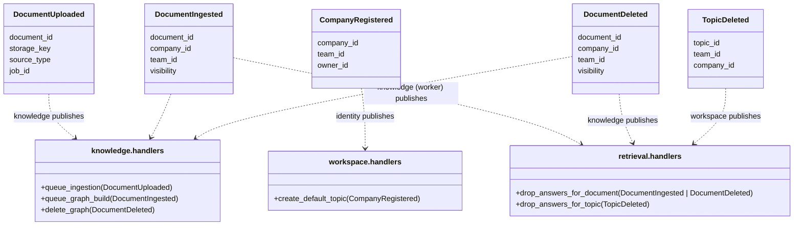
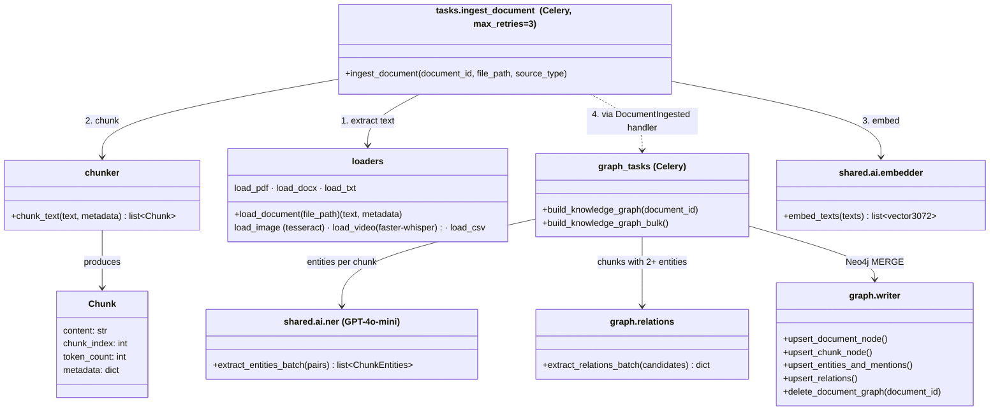
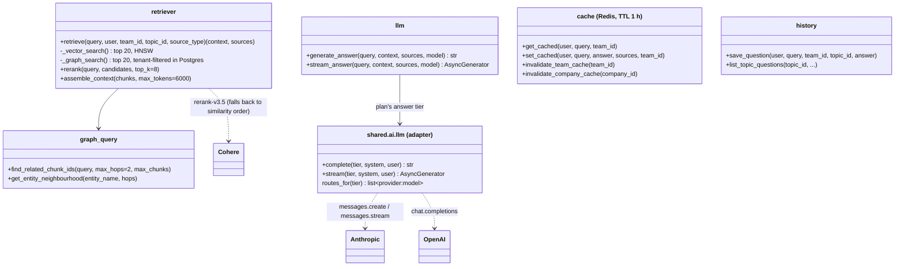

# Module Diagram

The backend is one Python package, `backend/app`, split into modules (bounded
contexts). Each module exposes a public `api.py`; everything else in the
module is internal and may not be imported by other modules (enforced by
`lint-imports` and `tests/architecture/test_boundaries.py`).

Modules are mostly plain async functions rather than classes, so each box below
is a **module** and its members are the functions that matter.

---

## Public module APIs and how modules depend on each other

Arrows point from caller to callee. Modules may only call **downward**:
retrieval → knowledge → workspace → identity → metering / notification / audit → shared.
Upward reactions go through domain events (see the next section).

```mermaid
classDiagram
    direction TB

    class retrieval_router["retrieval.router  /chat"] {
        +POST /chat
        +GET /chat/stream
        +GET /topics/{id}/questions
    }

    class knowledge_router["knowledge.router  /ingest"] {
        +POST /ingest
        +GET /ingest
        +GET /ingest/{document_id}
        +DELETE /ingest/{document_id}
        +GET /topics/{id}/documents
    }

    class knowledge_api["knowledge.api"] {
        <<events>>
        DocumentUploaded
        DocumentIngested
        DocumentDeleted
    }

    class workspace_api["workspace.api"] {
        +get_topic(topic_id) dict
        +require_topic_access(topic_id, user) dict
        <<event>> TopicDeleted
    }

    class identity_api["identity.api"] {
        +get_team(team_id, company_id) dict
        +TenantDirectory.count_teams(company_id) int
        +TenantDirectory.count_users(company_id) int
        <<event>> CompanyRegistered
    }

    class metering_api["metering.api"] {
        +open_subscription(company_id, plan)
        +get_plan(company_id) str
        +reserve_query(company_id) str
        +release_query(company_id)
        +check_storage_limit(company_id, bytes)
        +check_team_limit(company_id, team_count)
        +check_user_limit(company_id, user_count)
        +increment_storage(company_id, bytes)
        +decrement_storage(company_id, bytes)
        +set_tenant_directory(TenantDirectory)
    }

    class notification_api["notification.api"] {
        +send_invite_email(email, company_name, team_name, token)
        +send_password_reset_email(email, token)
    }

    class audit_api["audit.api"] {
        +log_event(company_id, event_type, ...)
    }

    class shared["shared"] {
        config · db · neo4j · celery
        security: get_current_user, can_access_team, require_company_admin
        rate_limit · events · observability · loop_local
        ai.embedder: embed_texts
        ai.ner: extract_entities, extract_entities_batch
    }

    retrieval_router --> workspace_api : topic access
    retrieval_router --> identity_api : team in company
    retrieval_router --> metering_api : reserve / release query
    retrieval_router --> audit_api : question.asked
    knowledge_router --> workspace_api : topic access
    knowledge_router --> identity_api : team in company
    knowledge_router --> metering_api : storage limit / counters
    knowledge_router --> audit_api : document.*
    identity_api --> metering_api : open_subscription, limits
    identity_api --> notification_api : invite / reset email
    identity_api --> audit_api
    metering_api ..> identity_api : TenantDirectory port (wired in bootstrap)
    retrieval_router --> shared
    knowledge_router --> shared
```

---

## Domain events

Lower modules announce events; higher modules (or the publisher itself) react.
Handlers are subscribed in `app/bootstrap.py`, which both the API and the worker
call at startup. Events are stored in `shared.outbox` in the publisher's
transaction and delivered after commit; a failing handler does not fail the
publisher, and the API's outbox relay retries the event later.



---

## Knowledge: ingestion pipeline (worker)



---

## Retrieval: answering a question


