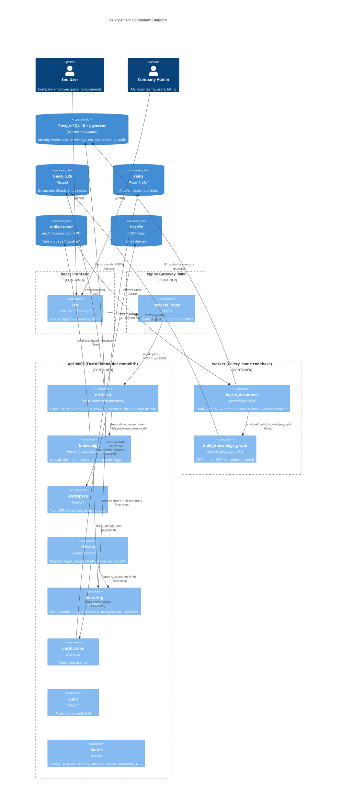

# Component Diagram

High-level view of the containers and the modules inside the API. Query-Prism
is a **modular monolith**: one `api` process and one Celery `worker`, both built
from `backend/`. Modules call each other in-process through their `api.py`;
the only cross-process hop inside the system is API → `redis-broker` → worker.



---

## Simplified Interaction Map

```
                 ┌──────────────┐
                 │ React (SPA)  │
                 └──────┬───────┘
                        │ HTTPS
                 ┌──────▼───────┐
                 │ Nginx :8000  │   every API path → api:8000
                 └──────┬───────┘
                        │
   ┌────────────────────▼──────────────── api ───────────────────────────┐
   │  retrieval ──► knowledge ──► workspace ──► identity                 │
   │      │             │              │            │                    │
   │      └─────────────┴──────────────┴────────────┴──► metering        │
   │                                                     notification    │
   │                                                     audit           │
   │  shared (config, db, security, events, AI clients)                  │
   └───────────────┬─────────────────────────────────────────────────────┘
                   │ send_task
           ┌───────▼────────┐        ┌──────────────────────────┐
           │  redis-broker  │──────► │  worker (Celery)         │
           └────────────────┘        │  ingest_document         │
                                     │  build_knowledge_graph   │
                                     └──────────────────────────┘
                   │                               │
   ┌───────────────▼───────────────────────────────▼──────────────┐
   │  PostgreSQL (schema per module)   Neo4j   redis (cache)       │
   └───────────────────────────────────────────────────────────────┘
```
