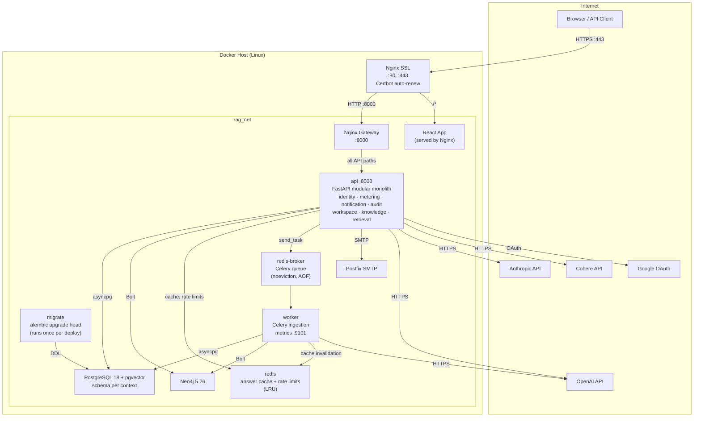

# Deployment Diagram

## Docker Compose Services



---

## Port Reference

| Container | Internal Port | Host Port | Accessible From |
|-----------|--------------|-----------|----------------|
| nginx-gateway | 80 | 8000 | Public (via SSL proxy) |
| api | 8000 | — | Internal + Gateway |
| worker | 9101 (metrics) | — | Internal |
| nginx-ssl | 80/443 | 80/443 | Public |

---

## Volume Mounts

| Volume | Mount Path | Purpose |
|--------|-----------|---------|
| `postgres_data` | `/var/lib/postgresql/data` | PostgreSQL persistent data |
| `neo4j_data` | `/data` | Neo4j persistent data |
| `redis_data` | `/data` | Answer cache snapshot (RDB) |
| `redis_broker_data` | `/data` | Celery broker persistence (AOF) |
| `uploads` | `/app/uploads` | Uploaded files awaiting ingestion (shared between api and worker; deleted after ingestion) |
| `certbot_conf` | `/etc/letsencrypt` | SSL certificate store |
| `certbot_www` | `/var/www/certbot` | ACME challenge files |

---

## Network Topology

All services share the `rag_net` Docker bridge network. There is no service-to-service
HTTP any more: contexts call each other in-process through their `api.py` modules, and
the API hands ingestion work to the worker through `redis-broker`.

```
api    → postgresql://postgres:5432   (search_path: identity, workspace, knowledge, retrieval, metering, audit, public)
api    → bolt://neo4j:7687
api    → redis://redis:6379/0          answer cache, rate limits
api    → redis://redis-broker:6379/0   enqueue ingestion
worker → same datastores; consumes redis-broker queue "ingestion"
```

---

## Production Deployment Checklist

- [ ] Set `SECRET_KEY` to a cryptographically random 32+ byte value (enforced at startup)
- [ ] Set `OPENAI_API_KEY`, `ANTHROPIC_API_KEY`, `COHERE_API_KEY`
- [ ] Set `GOOGLE_CLIENT_ID`, `GOOGLE_CLIENT_SECRET`, `GOOGLE_REDIRECT_URL`
- [ ] Configure `SMTP_*` environment variables for email delivery
- [ ] Configure Certbot with your domain for HTTPS
- [ ] Set `DATABASE_URL` with production credentials
- [ ] Set `NEO4J_PASSWORD` to a strong password
- [ ] Mount persistent volumes for PostgreSQL, Neo4j, Redis, and uploads
- [x] Enable Redis AOF persistence for durability (`redis-broker`)
- [ ] Schedule `procedures/backup.sh` nightly (cron) and set `BACKUP_S3_URI` for off-host copies
- [ ] Set up log rotation for all service containers
- [x] Flower runs only in the dev overlay, bound to 127.0.0.1
- [ ] Scrape `api:8000/metrics` and `worker:9101/metrics` with Prometheus
