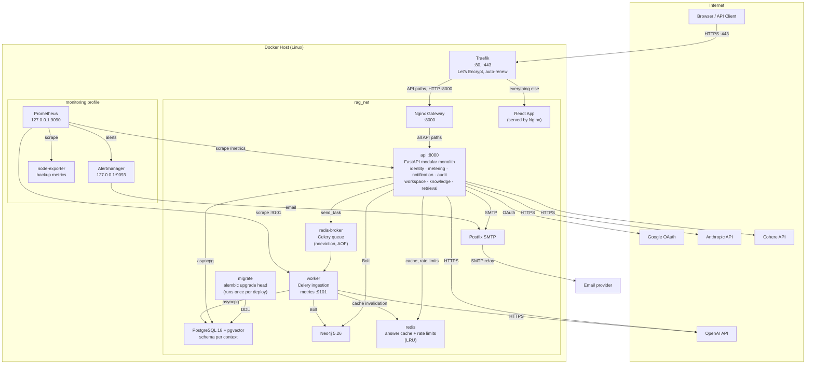

# Deployment Diagram

## Docker Compose Services



Ports, memory limits and volumes for each container: [services.md](../services.md).

---

## Network Topology

All services share the `rag_net` Docker bridge network. There is no service-to-service
HTTP any more: contexts call each other in-process through their `api.py` modules, and
the API hands ingestion work to the worker through `redis-broker`.

```
api    → postgresql://postgres:5432   (search_path: identity, workspace, knowledge, retrieval, metering, audit, public)
api    → bolt://neo4j:7687
api    → redis://redis:6379/0          answer cache, rate limits
api    → redis://redis-broker:6379/0   enqueue ingestion
worker → same datastores; consumes redis-broker queue "ingestion"
```

---

## Deploying

The step-by-step procedure (first install, update, rollback, health check) is
`.claude/skills/deploy/SKILL.md`; `procedures/deploy-check.sh preflight|verify`
checks the host, `.env`, DNS, firewall, containers, HTTPS and backups.
