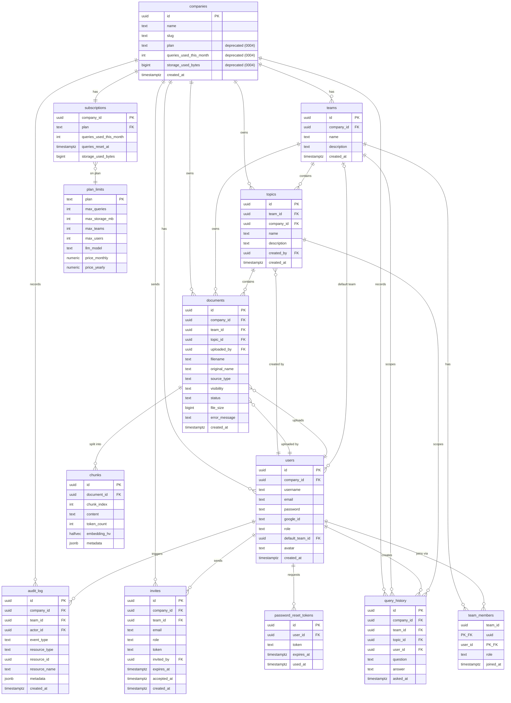
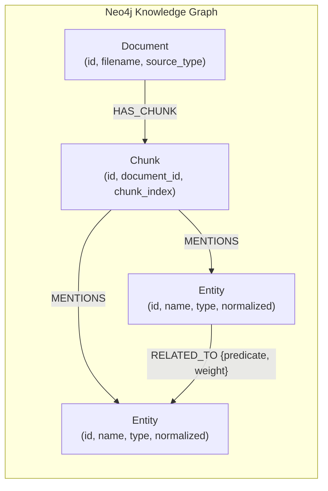

# Entity-Relationship Diagram

## Full PostgreSQL ER Diagram

---

## Neo4j Graph Schema

**Entity Types** (extracted by GPT-4o-mini, `app/shared/ai/ner.py`):
`Person`, `Organisation`, `Location`, `Product`, `Event`, `Work`, `Law`, `Date`,
`Money`, `Group`.

The graph stores no tenant ids; access rules are applied in PostgreSQL.

---

## Relationship Cardinality Summary

| Relationship | Cardinality | Notes |
|-------------|-------------|-------|
| Company → Teams | 1:N | A company has many teams |
| Company → Users | 1:N | All users belong to one company |
| Team ↔ Users | M:N | Via `team_members` junction |
| Team → Topics | 1:N | Topics are folders within teams |
| Team → Documents | 1:N | Documents are owned by teams |
| Topic → Documents | 1:N | Optional grouping |
| Document → Chunks | 1:N | A document is split into many chunks |
| User → Documents | 1:N | User uploads documents |
| Company → subscriptions | 1:1 | Plan and usage counters (`metering`) |
| Subscriptions → plan_limits | N:1 | Many companies on the same plan |
