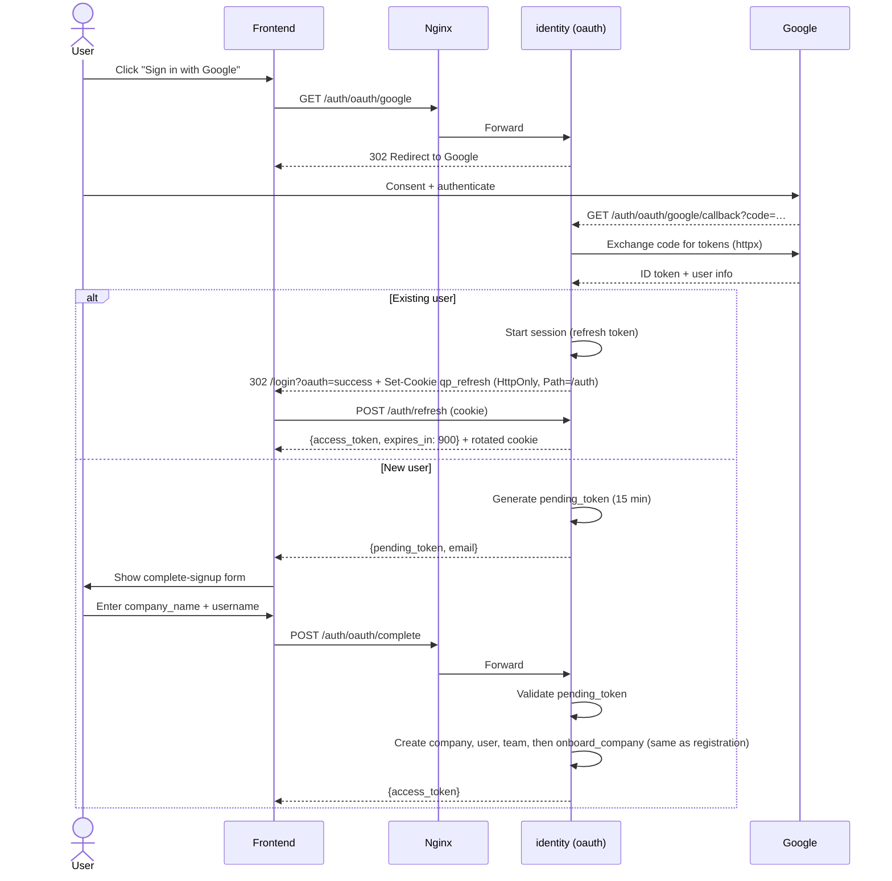
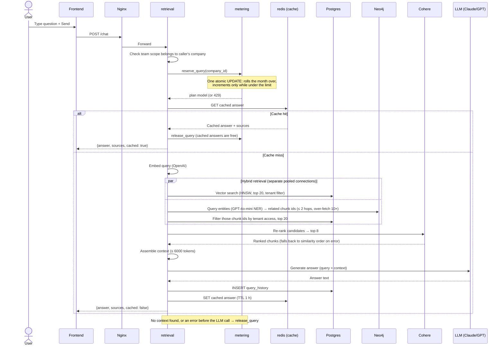
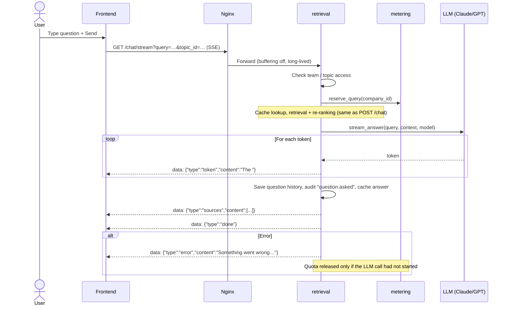

# Sequence Diagrams

All HTTP requests go Browser → Nginx gateway → `api` (one FastAPI process). Inside
`api`, participants are **modules** (`backend/app/<module>`) calling each other
in-process through their `api.py`; nothing here is a network hop except the
datastores, the Celery broker and external providers.

---

## 1. User Registration Flow

```mermaid
sequenceDiagram
    actor User
    participant Frontend
    participant Nginx
    participant Identity as identity
    participant Metering as metering
    participant Events as shared.events
    participant Workspace as workspace
    participant Postgres

    User->>Frontend: Fill registration form
    Frontend->>Nginx: POST /auth/register
    Nginx->>Identity: Forward to api:8000

    Identity->>Postgres: Check email uniqueness
    Postgres-->>Identity: Not found

    Identity->>Postgres: INSERT company
    Identity->>Postgres: INSERT user (owner)
    Identity->>Postgres: INSERT team "General"
    Identity->>Postgres: INSERT team_member (owner → General, admin)
    Identity->>Metering: open_subscription(company_id)
    Metering->>Postgres: INSERT metering.subscriptions (starter)
    Identity->>Events: publish CompanyRegistered
    Events->>Workspace: create_default_topic
    Workspace->>Postgres: INSERT topic "Main"

    Identity->>Identity: Start session; build 15-min access JWT
    Identity-->>Frontend: {access_token, expires_in} + Set-Cookie qp_refresh
    Frontend->>Frontend: Store token, redirect to app
```

---

## 2. Google OAuth Flow



---

## 3. Document Upload & Ingestion

```mermaid
sequenceDiagram
    actor User
    participant Frontend
    participant Nginx
    participant Knowledge as knowledge (api)
    participant Metering as metering
    participant Postgres
    participant Broker as redis-broker
    participant Worker as worker (Celery)
    participant OpenAI
    participant Retrieval as retrieval (cache handler)
    participant Neo4j

    User->>Frontend: Select file
    Frontend->>Nginx: POST /ingest (multipart)
    Nginx->>Knowledge: Forward

    Knowledge->>Knowledge: Check team / topic access, file type
    Knowledge->>Metering: check_storage_limit(company_id, size)
    Metering-->>Knowledge: OK (or 413)
    Knowledge->>Knowledge: Stream file in 1 MB pieces, then put() to upload storage (volume or S3)
    Knowledge->>Postgres: BEGIN; INSERT document (pending); INSERT outbox DocumentUploaded; COMMIT
    Knowledge->>Broker: DocumentUploaded handler: send_task("app.worker.ingest_document", task_id=job_id)
    Knowledge-->>Frontend: {document_id, job_id, status: "pending"}

    Note over Worker: Asynchronous; retried up to 3× (file kept between attempts)

    Worker->>Postgres: UPDATE document status=processing
    Worker->>Worker: Load file & extract text
    Worker->>Worker: Split into chunks (LlamaIndex, 512 tokens)
    Worker->>OpenAI: Embed chunks (text-embedding-3-large)
    OpenAI-->>Worker: 3072-dim vectors
    Worker->>Postgres: DELETE + INSERT chunks (halfvec) in one transaction
    Worker->>Postgres: BEGIN; UPDATE status=completed (only if not already); INSERT outbox DocumentIngested; COMMIT
    Worker->>Metering: increment_storage(company_id, file_size)
    Worker->>Retrieval: DocumentIngested handler → drop cached answers
    Worker->>Broker: DocumentIngested handler → send_task("app.graph_worker.build_knowledge_graph")

    Note over Worker: Graph task (same worker, separate task)
    Worker->>OpenAI: NER per chunk (GPT-4o-mini) + relation extraction
    Worker->>Neo4j: MERGE Document, Chunk, Entity nodes; MENTIONS / RELATED_TO edges

    Frontend->>Nginx: GET /ingest/{document_id} (polling)
    Nginx->>Knowledge: Forward
    Knowledge->>Postgres: SELECT document status
    Knowledge-->>Frontend: {status: "completed"}
```

---

## 4. Chat Query (Non-Streaming)



---

## 5. Streaming Chat (SSE)



---

## 6. Team Invitation Flow

```mermaid
sequenceDiagram
    actor Admin
    actor Invitee
    participant Frontend
    participant Identity as identity
    participant Metering as metering
    participant Notification as notification
    participant Email as Postfix
    participant Postgres

    Admin->>Frontend: Enter invitee email + team
    Frontend->>Identity: POST /auth/invite

    Identity->>Identity: Require company admin; team must be in caller's company
    Identity->>Postgres: INSERT invite (token, expires_at = +24 h)
    Identity->>Notification: send_invite_email(...)
    Notification->>Email: HTML invite email via SMTP (failures logged, not raised)
    Email-->>Invitee: Invitation email

    Identity-->>Frontend: {id, token, email, expires_at}

    Invitee->>Frontend: Click link in email
    Frontend->>Identity: GET /auth/invite/{token}
    Identity->>Postgres: SELECT invite by token
    Identity-->>Frontend: Invite preview (company, team, email)

    Invitee->>Frontend: Set username + password
    Frontend->>Identity: POST /auth/invite/{token}/accept
    Identity->>Postgres: Validate token (not expired, not used)
    Identity->>Metering: check_user_limit(company_id, user_count)
    Metering-->>Identity: OK (or 403)
    Identity->>Postgres: INSERT user, team_member; mark invite accepted
    Identity-->>Frontend: {access_token}
```

---

## 7. Password Reset Flow

```mermaid
sequenceDiagram
    actor User
    participant Frontend
    participant Identity as identity
    participant Notification as notification
    participant Postgres

    User->>Frontend: Enter email on forgot-password page
    Frontend->>Identity: POST /auth/forgot-password {email}

    Identity->>Postgres: SELECT user by email
    alt User exists
        Identity->>Postgres: INSERT password_reset_tokens (expires = +1 h)
        Identity->>Notification: send_password_reset_email(...)
        Notification-->>User: Password reset email
    end

    Note over Identity: Always returns 204 (prevents email enumeration)
    Identity-->>Frontend: 204 No Content

    User->>Frontend: Click link, enter new password
    Frontend->>Identity: POST /auth/reset-password {token, new_password}
    Identity->>Postgres: SELECT token (valid, not expired, not used)
    Identity->>Postgres: UPDATE user password; mark token used
    Identity-->>Frontend: 204 No Content
```
